# Installing osTicket on a Windows Virtual Machine in Microsoft Azure

**Author:** Kris Lavallais  
**Project type:** Application installation walkthrough  
**Environment:** Microsoft Azure virtual machine running Windows 10, accessed through Remote Desktop

## Project summary

I installed osTicket, an open-source help desk ticketing application, on a Windows virtual machine hosted in Microsoft Azure. This walkthrough shows how I enabled Internet Information Services (IIS), configured PHP, installed MySQL, connected osTicket to its database, and completed the web-based installer.

The starting point is an existing Azure VM with administrator access. The installation video demonstrates the process through the successful installer screen. Screenshots from that recording document the installation steps. Administrator login, cleanup, and final verification are included as follow-up instructions after the recorded installation.

**Languages and scripting:** No custom scripts or application code were written for this project. PHP is the runtime used by osTicket, and MySQL stores its data.

**Result:** osTicket installed successfully, as shown in the video and the installer success screenshot. The instructions below explain how to check administrator access and complete the final file-permission and setup-folder cleanup before further configuration.

## Video walkthrough

**[Watch the full walkthrough on YouTube](https://www.youtube.com/watch?v=5FxwlTwsrdk)** — approximately 15 minutes. Each installation section below links to the matching point in the video.

## Environment and technologies

| Technology | Purpose in this project |
| --- | --- |
| Microsoft Azure Virtual Machines | Hosts the Windows lab computer |
| Windows 10 | Operating system used in the recording |
| Remote Desktop Connection | Provides access to the Azure VM |
| IIS and its CGI feature | Serves the application and supports PHP through FastCGI |
| PHP Manager for IIS | Registers PHP and manages its extensions |
| IIS URL Rewrite Module | Supports the application's URL rewrite rules |
| PHP 7.3.8 | Executes the osTicket application |
| Visual C++ Redistributable | Provides runtime libraries required by the recorded PHP build |
| MySQL 5.5.62 | Stores osTicket's application data |
| HeidiSQL 12.3 | Provides a graphical interface for database creation |
| osTicket 1.15.8 | Help desk application installed in this lab |

These are the versions used in the recorded course lab. Use the matching lab bundle to reproduce this walkthrough. For a new deployment, consult the [current osTicket installation documentation](https://docs.osticket.com/en/latest/Getting%20Started/Installation.html) for supported dependencies; newer osTicket releases have different requirements.

## Before you begin

- Have an existing Azure Windows VM, its current connection address, and its administrator credentials available.
- Confirm that you can sign in through Remote Desktop. The VM's inbound rules must permit that connection from your client.
- Perform the application installation steps **inside the VM**.
- Obtain the `osTicket-Installation-Files` ZIP supplied in your course's osTicket installation lesson. It contains the matching installers used in the video.
- Keep the MySQL password and the separate osTicket administrator password available for their respective setup screens.

Use your own VM, MySQL, and osTicket credentials when following this walkthrough. The recording temporarily grants `Everyone` full control of one configuration file for the course lab. The cleanup section explains how to remove that file's temporary write permissions. A real deployment should use strong credentials and a dedicated application database account.

## Contents

1. [Start and access the Azure VM](#1-start-and-access-the-azure-vm)
2. [Download and extract the installation bundle](#2-download-and-extract-the-installation-bundle)
3. [Enable IIS and CGI](#3-enable-iis-and-cgi)
4. [Install PHP Manager and URL Rewrite](#4-install-php-manager-and-url-rewrite)
5. [Prepare PHP and its runtime dependency](#5-prepare-php-and-its-runtime-dependency)
6. [Install and configure MySQL](#6-install-and-configure-mysql)
7. [Register PHP in IIS](#7-register-php-in-iis)
8. [Place osTicket in the IIS web directory](#8-place-osticket-in-the-iis-web-directory)
9. [Check prerequisites and enable PHP extensions](#9-check-prerequisites-and-enable-php-extensions)
10. [Prepare the osTicket configuration file](#10-prepare-the-osticket-configuration-file)
11. [Grant temporary installer permissions](#11-grant-temporary-installer-permissions)
12. [Enter help desk and administrator information](#12-enter-help-desk-and-administrator-information)
13. [Create the database with HeidiSQL](#13-create-the-database-with-heidisql)
14. [Complete installation and check administrator access](#14-complete-installation-and-check-administrator-access)
15. [Complete installation cleanup](#15-complete-installation-cleanup)
16. [Verify the finished installation](#16-verify-the-finished-installation)

## Step-by-step installation

### 1. Start and access the Azure VM

**Video:** [00:00](https://www.youtube.com/watch?v=5FxwlTwsrdk&t=0s)

1. Sign in to the Azure portal and open **Virtual machines**.
2. Select the existing VM. In the recording, its name is `osTicket-vm`.
3. If it is stopped, select **Start** and wait until its status is **Running**.
4. Obtain its current public IP address from **Overview**.
5. On your own computer, open **Remote Desktop Connection**, enter that address, and select **Connect**.
6. Sign in with the administrator account created for your VM and accept the connection prompt for this lab VM if shown.

**Expected result:** The remote Windows desktop opens. Continue working inside that desktop so the application is installed on the Azure VM.

### 2. Download and extract the installation bundle

**Video:** [01:07](https://www.youtube.com/watch?v=5FxwlTwsrdk&t=67s)

1. Inside the VM, open Microsoft Edge, sign in to your course if needed, and open its osTicket installation lesson.
2. Download the lesson's `osTicket-Installation-Files` ZIP and locate it in **File Explorer → Downloads**.
3. Right-click the ZIP and select **Extract All**.
4. Choose the desktop as the destination, then select **Extract**.
5. Open the extracted folder, including the nested `osTicket-Installation-Files` folder if present.
6. Confirm that the bundle contains PHP Manager, URL Rewrite, PHP, Visual C++ Redistributable, MySQL, HeidiSQL, and the osTicket archive.

**Expected result:** All prerequisite installers and application files are available in one folder.

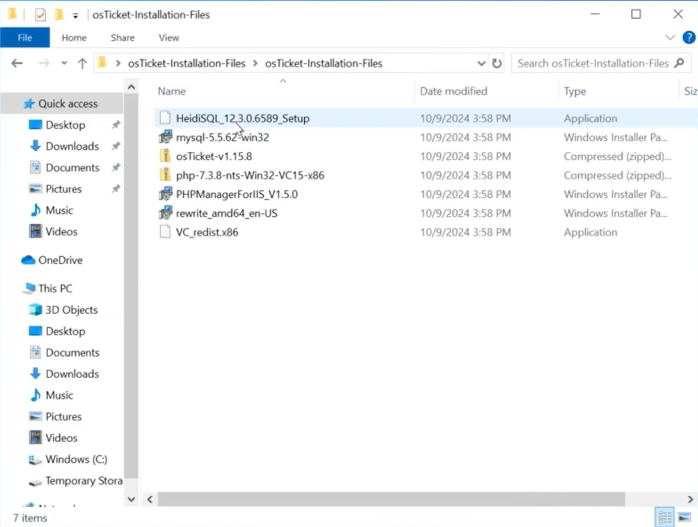

*Installation video, approximately 04:07: the extracted bundle used throughout the walkthrough.*

### 3. Enable IIS and CGI

**Video:** [02:11](https://www.youtube.com/watch?v=5FxwlTwsrdk&t=131s)

1. In Edge, visit `http://127.0.0.1`. Before IIS is enabled, the recording shows a connection-refused page.
2. Open **Control Panel → Programs → Programs and Features**. If Control Panel uses category view, **Uninstall a program** opens Programs and Features.
3. Select **Turn Windows features on or off**.
4. Enable **Internet Information Services**.
5. Under **Web Management Tools**, confirm **IIS Management Console** is selected.
6. Expand **Internet Information Services → World Wide Web Services → Application Development Features** and select **CGI**.
7. Select **OK** and allow Windows to install the features.
8. Return to Edge and refresh `http://127.0.0.1`.

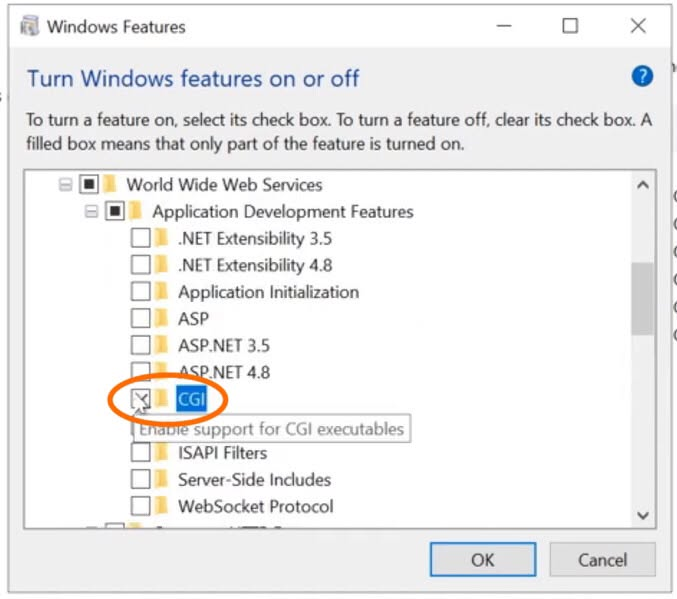

*Installation video, approximately 03:24: CGI is enabled under IIS Application Development Features.*

**Expected result:** The default IIS welcome page loads. This confirms the VM can serve a web page locally.

`127.0.0.1` is the loopback address: in the VM's browser, it points to the VM itself. This is an HTTP web-server check, distinct from using `ping` to test ICMP responses.

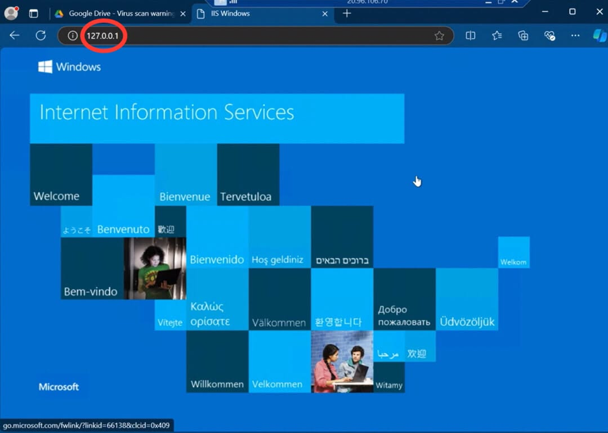

*Installation video, approximately 03:47: IIS responds successfully after its features are enabled.*

### 4. Install PHP Manager and URL Rewrite

**Video:** [03:56](https://www.youtube.com/watch?v=5FxwlTwsrdk&t=236s)

1. Return to the extracted installation bundle.
2. Open the **PHP Manager for IIS** installer, displayed as `PHPManagerForIIS_V1.5.0` in the recording.
3. Accept the license agreement and complete the installation wizard.
4. Open the **IIS URL Rewrite Module** installer, displayed as `rewrite_amd64_en-US`.
5. Accept its agreement, install the module, and close the wizard.

**Expected result:** IIS Manager includes **PHP Manager** and **URL Rewrite** features. If IIS Manager was already open, close and reopen it to refresh the feature list.

### 5. Prepare PHP and its runtime dependency

**Video:** [04:40](https://www.youtube.com/watch?v=5FxwlTwsrdk&t=280s)

1. Open **File Explorer → This PC → Windows (C:)**.
2. Right-click an empty area, choose **New → Folder**, and name the folder `PHP`.
3. In the installation bundle, right-click the PHP ZIP archive and select **Extract All**.
4. Set the extraction destination to `C:\PHP`, then select **Extract**.
5. Open `C:\PHP` and confirm that `php-cgi.exe` is directly in that folder, rather than inside an extra nested folder.
6. Return to the bundle and run `VC_redist.x86.exe`, which matches the PHP build used in the recording.
7. Accept the agreement and complete the Visual C++ Redistributable installation.

**Expected result:** `C:\PHP\php-cgi.exe` exists and the required Visual C++ runtime is installed. The next IIS configuration step will use that exact executable path.

### 6. Install and configure MySQL

**Video:** [05:55](https://www.youtube.com/watch?v=5FxwlTwsrdk&t=355s)

1. Open the MySQL installer in the bundle, displayed as `mysql-5.5.62-win32`.
2. Select **Next**, accept the license agreement, and choose **Typical** installation.
3. Complete installation and keep the option to launch the configuration wizard selected.
4. In the configuration wizard, choose **Standard Configuration**.
5. Keep MySQL configured as a Windows service and continue to its security settings.
6. Create a unique password for MySQL's default administrator account, `root`, and enter it twice. Keep it available for the database connection steps.
7. Leave remote root access and anonymous-account creation unchecked, as shown in the recording.
8. Select **Execute** to apply the configuration, then **Finish**.

**Expected result:** MySQL is installed and its local service starts. HeidiSQL will verify the connection in step 13.

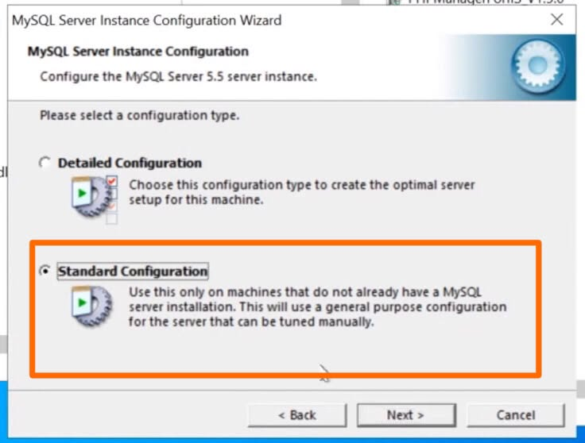

*Installation video, approximately 06:12: Standard Configuration is selected for the lab database server.*

### 7. Register PHP in IIS

**Video:** [07:03](https://www.youtube.com/watch?v=5FxwlTwsrdk&t=423s)

1. Open **Start**, search for **Internet Information Services (IIS) Manager**, and select **Run as administrator**.
2. Select the VM/server node in the left **Connections** pane.
3. Double-click **PHP Manager** in the center pane.
4. Select **Register new PHP version**.
5. Browse to `C:\PHP\php-cgi.exe`, select it, and confirm with **OK**.
6. Check that PHP Manager displays the PHP version and executable path.
7. Select the server node, then use **Stop** and **Start** in the right **Actions** pane, as demonstrated in the video.

**Expected result:** PHP Manager displays version **7.3.8** and executable **`C:\PHP\php-cgi.exe`**. IIS can now pass PHP requests to the registered runtime.

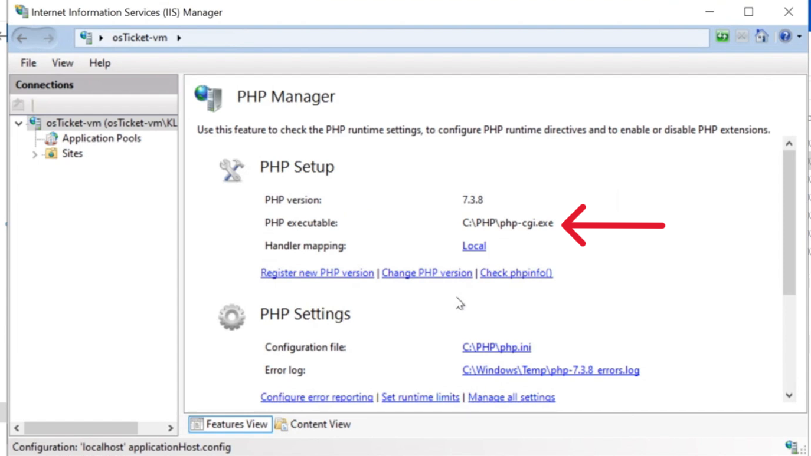

*Installation video, approximately 07:22: PHP is registered in IIS.*

### 8. Place osTicket in the IIS web directory

**Video:** [08:04](https://www.youtube.com/watch?v=5FxwlTwsrdk&t=484s)

1. In the installation bundle, right-click the osTicket 1.15.8 archive and select **Extract All**.
2. Open the extracted osTicket folder and locate its `upload` folder.
3. In another File Explorer window, navigate to `C:\inetpub\wwwroot`.
4. Move the entire `upload` folder into `wwwroot`.
5. Rename the moved folder to `osTicket`.
6. Confirm that `C:\inetpub\wwwroot\osTicket` contains application files and folders such as `include`, `scp`, and `setup`.
7. Return to IIS Manager and stop and start the server again, as demonstrated.

**Expected result:** The application resides at `C:\inetpub\wwwroot\osTicket` and its local URL is `http://localhost/osTicket/`.

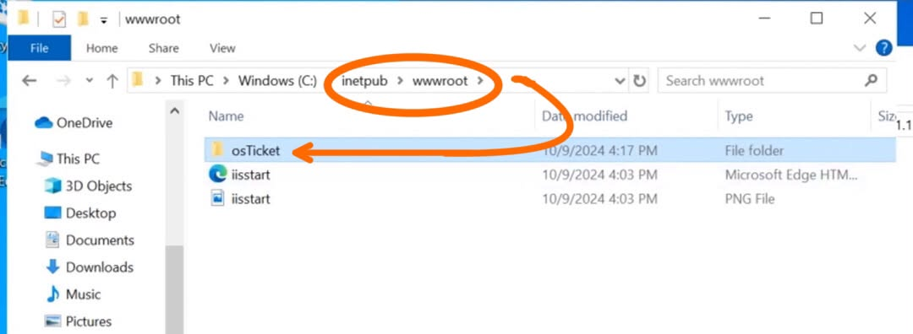

*Installation video, approximately 09:11: the osTicket folder is in the IIS web directory.*

### 9. Check prerequisites and enable PHP extensions

**Video:** [09:39](https://www.youtube.com/watch?v=5FxwlTwsrdk&t=579s)

1. In IIS Manager, expand **Sites → Default Web Site** and select `osTicket`. Refresh the tree if the folder does not appear immediately.
2. Use **Browse** in the Actions pane, or open `http://localhost/osTicket/setup/` directly in Edge.
3. Review the installer's **Required** and **Recommended** prerequisite lists. All required checks must pass before proceeding.
4. Return to IIS Manager, select the `osTicket` node, open **PHP Manager**, and select **Enable or disable an extension**.
5. Find `php_imap.dll`, select it, and select **Enable**. This supports IMAP email fetching.
6. Find `php_intl.dll`, select it, and select **Enable**. This supports internationalization/localization.
7. Refresh the installer page and verify that the corresponding checks turn green.

**Expected result:** Required checks pass, and IMAP and Intl are available. The screenshot below documents that state.

**OPcache observation:** The video also selects `php_opcache.dll`, but the refreshed installer still marks **Zend OPcache Extension** with a red X. This walkthrough therefore does not claim that OPcache was successfully activated. The installer identifies it as a recommended performance extension, and installation succeeds with it unavailable in this lab.

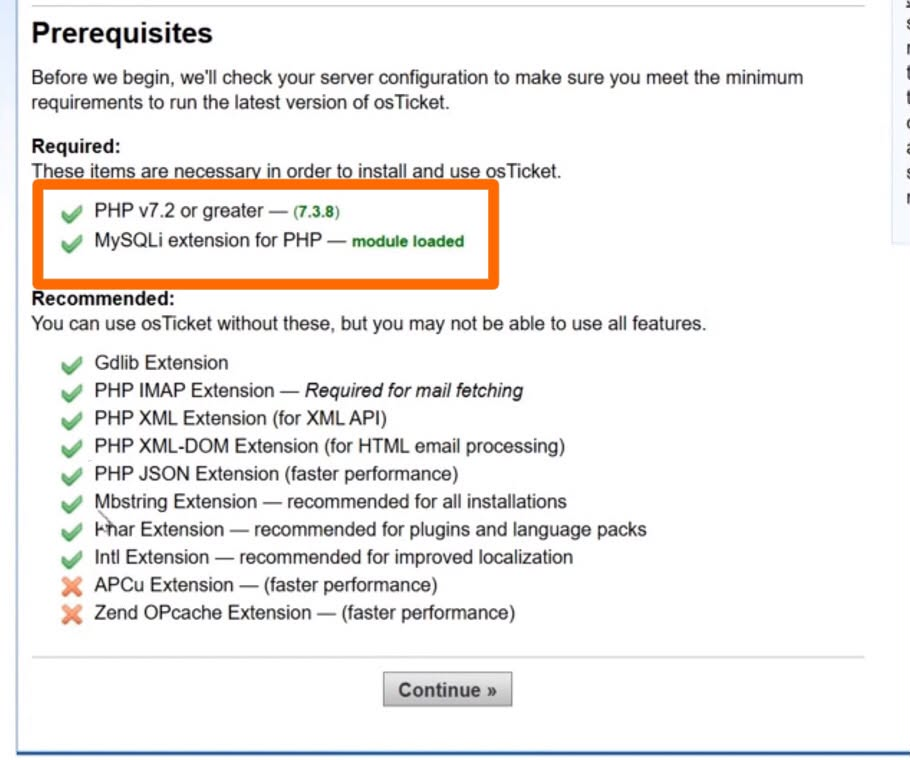

*Installation video, approximately 11:04: required checks pass; the optional APCu and Zend OPcache checks remain red.*

### 10. Prepare the osTicket configuration file

**Video:** [11:12](https://www.youtube.com/watch?v=5FxwlTwsrdk&t=672s)

1. Open File Explorer and navigate to `C:\inetpub\wwwroot\osTicket\include`.
2. On the **View** tab, enable **File name extensions** so you can verify the complete filename.
3. Locate `ost-sample-config.php`.
4. Right-click it, select **Rename**, and change its name to `ost-config.php`.
5. Keep the `.php` extension intact.

**Expected result:** `C:\inetpub\wwwroot\osTicket\include\ost-config.php` exists. The installer will write its database and application configuration into this file.

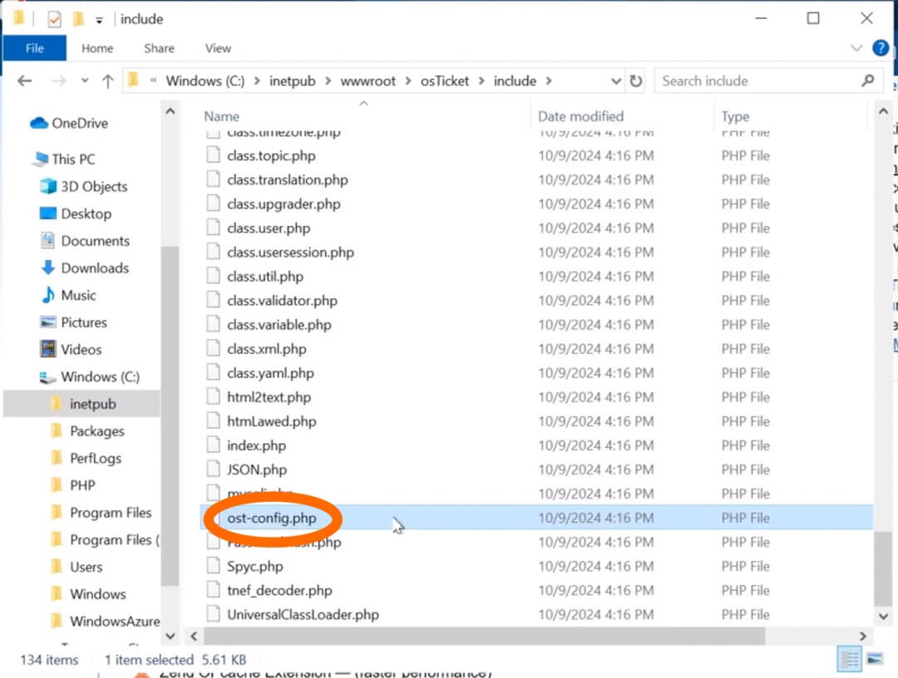

*Installation video, approximately 11:34: the configuration file has been renamed.*

### 11. Grant temporary installer permissions

**Video:** [11:34](https://www.youtube.com/watch?v=5FxwlTwsrdk&t=694s)

1. Right-click `ost-config.php` and select **Properties → Security → Advanced**.
2. Select **Disable inheritance**, then **Remove all inherited permissions from this object**, matching the recorded lab procedure.
3. Select **Add → Select a principal**.
4. Enter `Everyone`, select **Check Names**, and select **OK**.
5. Select **Full control**, then select **OK → Apply** and close the property dialogs.
6. Return to the browser and select **Continue** on the installer page.

**Expected result:** The installer can write to `ost-config.php` and advances to its information-entry form.

This temporary permission applies to this single configuration file. Complete step 15 after installation to remove the broad write access.

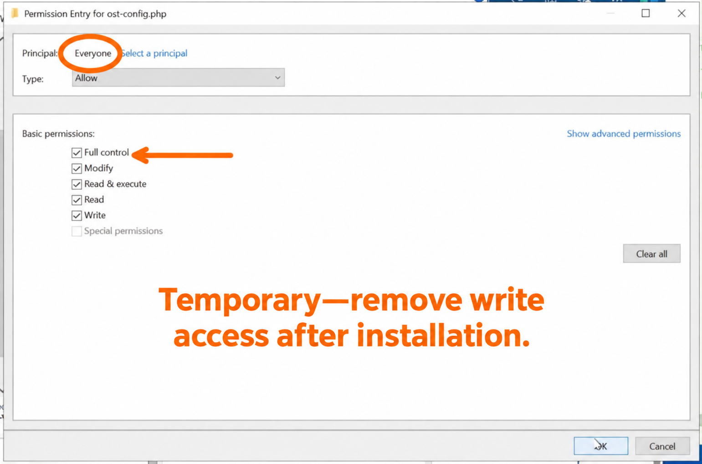

*Installation video, approximately 12:15: the lab grants temporary full control for the configuration file.*

### 12. Enter help desk and administrator information

**Video:** [12:25](https://www.youtube.com/watch?v=5FxwlTwsrdk&t=745s)

1. On the installer form, complete **System Settings**.
2. Enter the **Helpdesk Name**, such as `Lavallais IT Help Desk` from the recording.
3. Enter the **Default Email** for your lab help desk and select the primary language.
4. Under **Admin User**, enter the administrator's first name, last name, and email address.
5. Choose your osTicket administrator username and keep it available for the login step.
6. Enter and confirm the osTicket administrator password. This account is separate from the MySQL root account.
7. Leave the form open while creating the database in the next step.

**Expected result:** The help desk and administrator fields are complete. The database connection information is the remaining requirement before selecting **Install Now**.

### 13. Create the database with HeidiSQL

**Video:** [13:27](https://www.youtube.com/watch?v=5FxwlTwsrdk&t=807s)

1. Open the HeidiSQL installer from the bundle.
2. Complete its installation wizard and launch HeidiSQL.
3. In **Session manager**, select **New**.
4. Use the local MySQL connection settings:

   | Setting | Value to enter |
   | --- | --- |
   | Network type | MariaDB or MySQL (TCP/IP) |
   | Hostname / IP | `127.0.0.1` |
   | User | `root`, the default MySQL administrator account |
   | Password | The MySQL password you created in step 6 |
   | Port | `3306` |

5. Select **Open** to connect.
6. Right-click the connected server/session in the left pane and choose **Create new → Database**.
7. Enter `osTicket` as the database name, leave the default collation used in the recording, and select **OK**.
8. Confirm that `osTicket` appears in the database list.

**Expected result:** HeidiSQL connects successfully and the `osTicket` database exists. The installer will create the application's tables inside it.

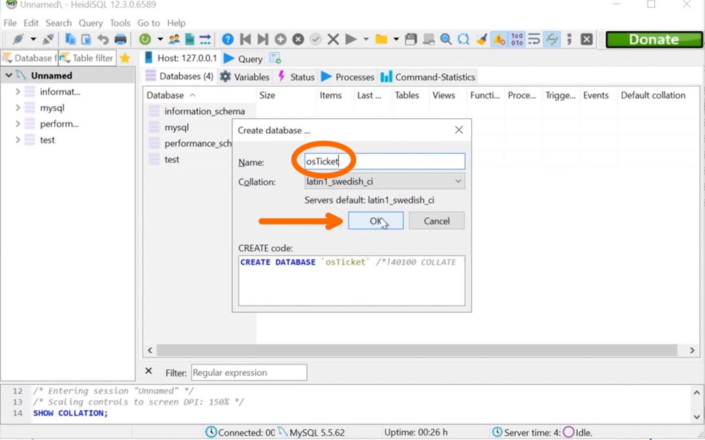

*Installation video, approximately 14:30: the database is named osTicket.*

### 14. Complete installation and check administrator access

**Video:** [14:34](https://www.youtube.com/watch?v=5FxwlTwsrdk&t=874s)

1. Return to the open osTicket installer form.
2. Under **Database Settings**, enter the following:

   | Installer field | Value to enter |
   | --- | --- |
   | MySQL Table Prefix | `ost_` |
   | MySQL Hostname | `localhost` |
   | MySQL Database | `osTicket` |
   | MySQL Username | `root`, the default MySQL administrator account |
   | MySQL Password | The MySQL password you created in step 6 |

   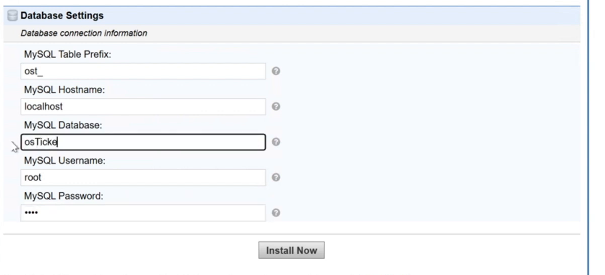

   *Installation video, approximately 14:48: the installer is configured to use the osTicket database; the password is masked.*

3. Select **Install Now** and wait for the installation to finish.
4. Confirm that the installer displays **Congratulations!** and reports that installation completed successfully.

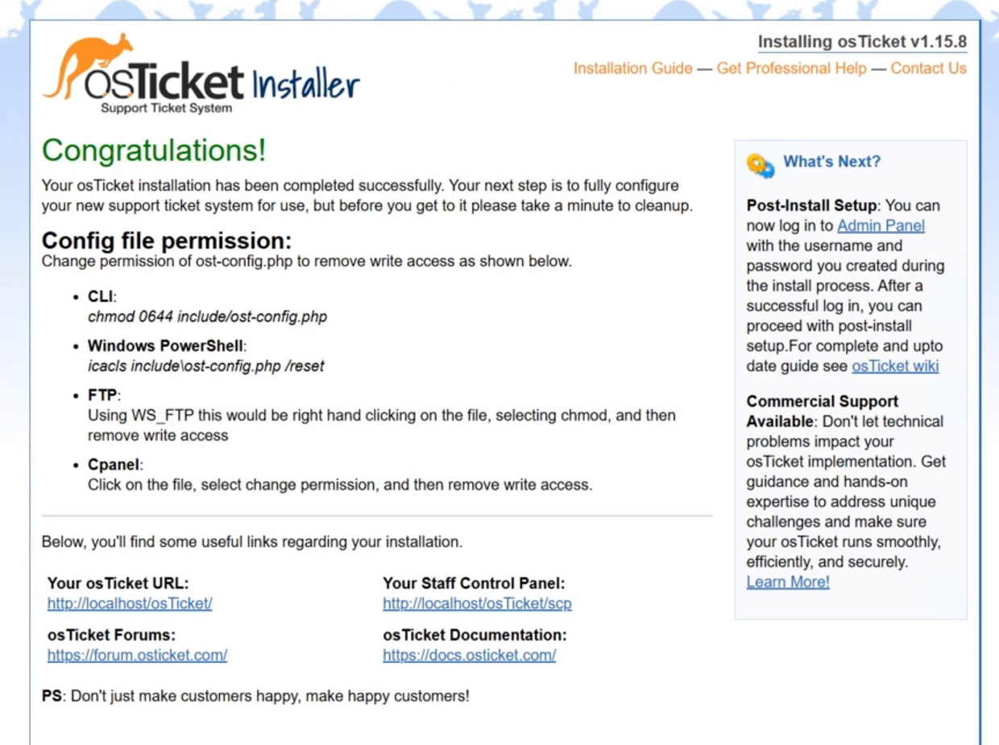

*Installation video, approximately 15:17: the installer reports success and prompts for cleanup.*

**Follow-up administrator access check:** The recording ends at the installer success screen. Complete the following login check after installation.

5. Open `http://localhost/osTicket/scp/` and sign in with the osTicket administrator account from step 12.
6. Select **Admin Panel** if you initially land in the Agent Panel. Confirm that administrator settings are accessible.

**Expected result:** The installer completes successfully and the administrator can access osTicket's control panel.

### 15. Complete installation cleanup

**Follow-up instructions:** The installation video ends at the success screen, where osTicket prompts for cleanup. Complete the steps below afterward. The [osTicket 1.15.8 installation guide](https://docs.osticket.com/en/v1.15.8/Getting%20Started/Installation.html#finishing-up) also describes the required configuration-file and setup-directory cleanup.

#### Remove temporary write access

1. Navigate to `C:\inetpub\wwwroot\osTicket\include`.
2. Right-click `ost-config.php` and select **Properties → Security → Edit**.
3. Select the temporary `Everyone` entry created in step 11.
4. Clear **Allow** for **Full control**, **Modify**, and **Write**. Keep **Read** and **Read & execute** allowed.
5. Leave the **Deny** boxes unchecked. Select **Apply**, then **OK**.
6. If other permission entries are present, ensure they do not grant the application's runtime unnecessary write access to this configuration file. Keep appropriate administrative access for maintenance.

**Expected result:** The temporary `Everyone` entry can read the configuration file but cannot modify it; osTicket can still load its configuration.

#### Delete the setup directory

1. Navigate to `C:\inetpub\wwwroot\osTicket`.
2. Confirm that you are selecting the folder named **`setup`**.
3. Right-click **`setup`**, select **Delete**, and confirm if prompted. Keep the `include` and `scp` folders.
4. Refresh the osTicket Admin Panel.

**Expected result:** The `setup` folder is removed and the warning asking you to delete it disappears.

#### Confirm help desk status

1. Open **Admin Panel → Settings → System**.
2. Find **Helpdesk Status** and select **Online** if it is not already selected.
3. Select **Save Changes** if you changed the setting.

**Expected result:** The help desk is enabled for use. Roles, departments, agents, SLAs, and help topics can now be configured in the companion project.

### 16. Verify the finished installation

After cleanup, use the following checks inside the VM:

| Check | How to verify | Expected result |
| --- | --- | --- |
| IIS responds locally | Browse to `http://127.0.0.1` | Default IIS welcome page loads |
| osTicket portal loads | Browse to `http://localhost/osTicket/` | Client help desk page loads without a PHP or database error |
| Administrator can sign in | Browse to `http://localhost/osTicket/scp/` and use the administrator account | Agent/Admin Panel opens |
| Configuration permissions are reduced | Inspect `include\ost-config.php` under Properties → Security | Temporary Everyone entry has read access without Full control, Modify, or Write |
| Installer is removed | Inspect `C:\inetpub\wwwroot\osTicket` and refresh the Admin Panel | No setup folder or delete-setup warning |
| Help desk is enabled | Check Admin Panel → Settings → System | Helpdesk Status is Online |

**Evidence provided:** The video and installation screenshots document the process through installer success. Administrator login, cleanup, and the table above describe follow-up checks to perform after installation; they are not shown in this recording and do not represent a new test run against a live VM.

## Troubleshooting

| Symptom | What to check |
| --- | --- |
| `127.0.0.1` refuses the browser connection | Confirm IIS is enabled and the server and Default Web Site are started |
| PHP Manager does not display a PHP version | Register `C:\PHP\php-cgi.exe`; confirm it is not inside a nested extraction folder |
| Installer reports a missing required prerequisite | Read the specific failed check, enable or install the indicated dependency, and refresh |
| IMAP or Intl is missing | Enable `php_imap.dll` or `php_intl.dll` in PHP Manager and refresh the installer |
| OPcache remains red | The recording did not verify successful activation; treat it as an optional performance item for this lab |
| Installer cannot write the configuration file | Verify the exact filename and temporary installer permissions in steps 10–11 |
| Database connection fails | Confirm MySQL is running, the database name is `osTicket`, and the entered credentials match the MySQL account |
| osTicket opens a 404 page | Confirm the application files are in `C:\inetpub\wwwroot\osTicket` and use the matching URL |
| Admin Panel asks to delete setup | Complete the setup-directory cleanup in step 15 |

## Skills demonstrated

- Accessing and administering an Azure-hosted Windows VM through Remote Desktop.
- Enabling IIS features and verifying local HTTP service.
- Registering PHP through FastCGI and checking extension availability.
- Installing a MySQL service and creating an application database with HeidiSQL.
- Preparing application files and managing installation permissions.
- Completing a web-based application installer and recognizing its cleanup requirements.
- Documenting a technical procedure with written instructions, screenshots, expected results, and video evidence.

## Continue with post-installation configuration

The [osTicket post-installation configuration guide](https://github.com/KLavallais/osTicketPostSetup) covers roles, departments, teams, agents, users, SLAs, and help topics.

## References and media

- [My installation video](https://www.youtube.com/watch?v=5FxwlTwsrdk)
- [My companion configuration project](https://github.com/KLavallais/osTicketPostSetup)
- [osTicket 1.15.8 installation documentation](https://docs.osticket.com/en/v1.15.8/Getting%20Started/Installation.html)
- [osTicket 1.15.8 post-installation guide](https://docs.osticket.com/en/v1.15.8/Getting%20Started/Post-Installation.html)

All 12 installation screenshots are frames from my installation walkthrough, cropped to the relevant application windows. Arrows, circles, and the temporary-permission label highlight key settings. Captions identify the approximate video time and the state shown.
